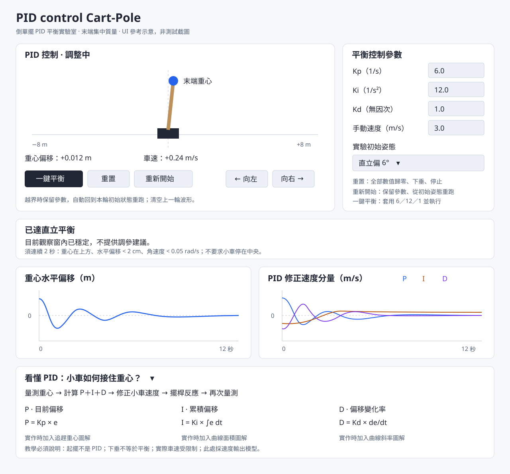

# PID control Cart-Pole — 實作規格書

版本：1.2｜日期：2026-10-13｜介面語言：繁體中文

本規格依使用者已確認的互動原型整理，供其他開發者或 AI 在沒有對話紀錄的情況下重建作品。文中的「必須」為驗收要求；參考圖是版面指引，不是可取代功能的截圖。

## 1. 成果、檔名與評分對應

**正式應用程式檔名必須為 `PID control Cart-Pole.html`，網頁標題與頁首名稱為 `PID control Cart-Pole`。** CSS、JavaScript、教學插圖全部內嵌，打開此單一檔案即可操作，不得依賴後端、建置程序、登入或 AI API。建議使用原生 HTML/CSS/JavaScript、Canvas 與內嵌 SVG，避免離線開啟失敗。

評分圖片仍要求可正常操作的 `index.html` 與 GitHub Pages。兼容方式：以 `PID control Cart-Pole.html` 為唯一維護主檔，部署時將其**逐位元複製為 `index.html`**。兩份是同一個自包含程式的不同檔名，不是拆成兩個相依程式；不要只提供轉址空殼，也不要獨立修改兩份。

交付目錄：

```text
PID control Cart-Pole.html       # 正式主檔，使用者指定名稱
index.html                      # 部署時生成，與主檔內容完全相同
PID-control-Cart-Pole-spec.md    # 本規格
ui-reference.svg                # 參考圖，僅供規格閱讀；應用不依賴它
ITERATION-AND-ACCEPTANCE.md       # 真實迭代紀錄及驗收紀錄
evidence/                       # 完成測試後才加入真實截圖／錄影
```

| 評分條件 | 本作品對應要求 | 應交證據 |
|---|---|---|
| 完整、明確的規格 | 本文件中的欄位範圍、運算模型、狀態、按鈕語意、驗收 ID | 本規格檔 |
| 正常操作的 HTML 與 GitHub Pages | 單檔可離線操作；部署根網址及具名 HTML 均可操作 | 公開 URL、實測日期、截圖 |
| 真正互動，不只靜態文字 | 參數改變動力學、鍵盤干擾、波形、狀態回饋 | 操作錄影或前後截圖與參數 |
| 作品與規格良好對應 | 第 12 節逐項驗收 | 結果、證據、缺失紀錄 |
| AI 反覆調整與完善 | 使用者要求→AI 修改→驗證→下一次修改 | 隨附真實迭代紀錄，不虛構 |

以上以對應 9～10 分條件為目標，實際分數由評分者決定；未部署、未測試的項目不得標為完成。

## 2. 產品目的與非目標

讓初學者藉由小車倒單擺，理解 P、I、D 的控制貢獻。核心操作是「填參數→執行→施加左右移動干擾→看重心與波形→修改→重跑」。

平衡目標是**末端重心位於移動中的小車支點正上方**，不是畫面中央，也不是小車回到原點。小車可以在擺桿直立時保持非零速度。

不提供重量設定、位置控制、真實馬達電路、感測雜訊、使用者帳號、雲端資料或自動尋找最佳 PID。只要模型忠實且教學正確，不追求完整機器人模擬。

## 3. 視覺參考與畫面構成



圖中曲線、讀值與狀態僅展示元件位置，不能當作模擬驗證結果。以本文件規定的真實資料更新畫面，不可硬編碼圖中的數值或曲線。

### 3.1 畫面區塊

1. 頁首：英文作品名稱＋中文用途說明。
2. 左上模型區：水平軌道、小車、擺桿、末端重心圓點、支點垂直線、狀態與偏移／車速。
3. 右上設定區：Kp、Ki、Kd、手動速度、實驗初始姿態、操作語意。
4. 三個主操作：一鍵平衡、重置、重新開始；不要新增開始／暫停鈕。
5. 方向操作：按住向左、按住向右；同時支援鍵盤。
6. 回饋區：以實際運動判定平衡，必要時才提供參數建議。
7. 波形區：水平偏移、P/I/D 分量兩張同步時間圖。
8. 教學區：可收合，預設展開，具有 P/I/D 圖解與公式。

### 3.2 視覺與可用性

- 以簡潔淺色介面為基準；白色區塊、深色文字、小車、暖色擺桿、明顯末端重心。可支援深色，但需保持對比。
- P、I、D 色彩固定對應，例如藍／橙／紫，另附文字圖例，不能只靠颜色辨識。
- 重心必須畫在擺桿末端，不能將支點標為重心。
- 軌道位置與擺桿長度若採不同視覺比例，須標示「示意比例」；不得讓圖上的尺規暗示相同比例。
- 桌面模型與設定並排；窄螢幕依序堆疊，320 px 寬仍可操作，不水平溢出。
- 文字、公式、按鈕不得重疊或被裁切；觸控操作目標至少約 44×44 px。
- 使用原生按鈕、標籤及數字輸入，保留鍵盤焦點樣式。狀態變化適度宣告，避免每個動畫影格朗讀。

## 4. 資料與初始值

| 名稱 | 符號／識別 | 範圍或固定值 | 單位／說明 |
|---|---|---|---|
| 比例增益 | Kp | 0～40，步進 0.1 | 1/s |
| 積分增益 | Ki | 0～40，步進 0.1 | 1/s² |
| 微分增益 | Kd | 0～10，步進 0.1 | 無因次 |
| 手動速度大小 | V | 0～3，步進 0.1 | m/s |
| 初始姿態 | initialPose | down / near | 下垂／直立向右偏 6° |
| 桿長 | L | 1 | m，末端集中質量、桿質量忽略 |
| 重力加速度 | g | 9.81 | m/s² |
| 角速度阻尼 | b | 0.02 | 1/s |
| 軌道範圍 | x | −8～+8 | m |
| 總車速上限 | vmax | 4 | m/s |
| 速度追蹤時間常數 | τ | 0.08 | s |
| PID 加速度上限 | amax | 20 | m/s² |
| 起擺加速度上限 | aswing | 12 | m/s² |
| 模擬步長 | dt | 1/240 | s |

首次開啟：Kp=Ki=Kd=0、V=3、下垂、車位 x=0、車速 v=0、角速度 ω=0、積分 z=0、待機。若提供儲存功能，必須明確標示恢復了設定，不能暗中恢復正在運行的實驗。

初始下垂 θ=π；直立偏 6° θ=π/30；θ=0 為直立，向右傾為正。垂直位置以向上為正。

數字欄位只接受有限數值；空白／非數字顯示就地錯誤並阻止套用；超界值提示允許範圍。修正前沿用最近一次有效值，不得產生 NaN、無限值或偷偷將空白轉成零。

## 5. 按鈕、初始快照與狀態

| 事件 | 保留／變更設定 | 物理與資料重設 | 執行結果 |
|---|---|---|---|
| 一鍵平衡 | PID=6/12/1；保留 V 與姿態選擇 | x,v,ω,z=0；按所選姿態設定 θ；清空時間／曲線／判斷／越界次數 | 立即運行 |
| 重置 | 所有數字輸入歸零，包括 V；姿態改下垂 | 車位歸 0、θ=π；清空動態與紀錄 | 停止待機 |
| 重新開始 | 保留全部有效輸入 | 按所選姿態重建同樣初始狀態，清空曲線／判斷／越界次數 | 立即運行 |
| 越界 | 保留當前增益與 V | 還原本輪啟動姿態與車位；清除速度、積分、曲線、時間、觀察與按鍵狀態 | 立即自動重跑，累計次數 |
| 平衡失敗 | 保留設定 | 保留最終畫面與曲線 | 停止，等待修改／重新開始 |

每次按「一鍵平衡」或「重新開始」，建立本輪初始快照：車位 0、速度 0、角速度 0、選定姿態。修改姿態選單只影響下一次手動啟動；越界依原快照重跑，不因選單變更而突然切換實驗。

狀態流程：

```text
待機 ──一鍵平衡／重新開始──→ 下垂初始：起擺 → 直立附近：PID
                            直立偏 6° 初始：直接 PID
PID ──超出平衡範圍──→ 失敗停止 ──重新開始──→ 新一輪
運行 ──越界──→ 清空本輪動態與波形 ──→ 相同初始快照，繼續運行
任意狀態 ──重置──→ 全部數字歸零、下垂、待機
```

改 Kp/Ki/Kd 即時生效，重新累計回饋觀察時間；Ki 改成 0 時清除 z，其他修改不任意清除積分。不得在每次修改時偷偷更換其他增益。

## 6. 手動干擾

- 右鍵為 +V，左鍵為 −V，兩鍵同按或都放開為 0。長按不累加速度指令。
- 滑鼠／觸控按住操作採 pointer capture，pointerup/pointercancel 清除；失焦也清除。
- 焦點在 input、select、textarea 或可編輯元素時，方向鍵不控制小車。
- 手動輸入在 PID 階段加入；起擺階段由獨立控制器接管並顯示提示，不能看似接受了實際卻忽略。
- V 是速度指令，不是力；加速、停止與換向會擾動擺桿。必須保留平滑過渡，不做瞬間速度跳變。
- 實际速度還受到 PID、速度及加速度上限影響，因此可以與手動方向不同。
- V=0 時提示「手動速度為 0」，不得偷偷提高；一鍵平衡也不更改 V。

## 7. 決定性控制與物理計算

以下為已測試原型的簡化模型。實作者不得換成力輸出 PID 卻沿用這組速度增益。公式中的數值參數採上述 SI 單位；起擺能量採 L=1 的歸一化表示，其控制增益隱含單位。

### 7.1 重心回授

```text
xCOM = x + L sin(θ)
yCOM = L cos(θ)
e = xCOM − x = L sin(θ)
de = L cos(θ) ω
θwrapped = atan2(sin(θ), cos(θ))
```

此處 e 採「實際水平偏移」，右偏為正，控制方向為小車向右追。若改用通常的「目標−實際」誤差，必須同步反轉控制符號，不能混用。

### 7.2 PID 速度指令

```text
zCandidate = Ki > 0 ? z + e·dt : 0
P = Kp·e
I = Ki·zCandidate
D = Kd·de
raw = vManual + P + I + D
vCommand = clamp(raw, −4, +4)
a = clamp((vCommand − v)/0.08, −20, +20)
```

若 Ki>0、|raw|>4 且 raw·e>0，拒絕本步積分增量（z 保持舊值）；其他情況接受 zCandidate。Ki=0 時 z 必為 0。P/I/D 圖應記錄本步實際用來計算 raw 的分量，不能把拒絕積分後的值誤標成該步已施加輸出。這是條件積分防飽和，並非完整的加速度飽和補償。

速度／加速度受限的取樣需標記，供回饋統計。raw、分量、受限指令和實際車速不得混淆。

### 7.3 獨立起擺

```text
E = 0.5·ω² + 9.81·cos(θ)
a = clamp((E−9.81)·ω·cos(θ) − 0.3·v, −12, +12)
若 |ω|<0.03 且 |θwrapped|>3：a = 3
若 |v|>=4 且 a·v>0：a = 0
```

起擺 P/I/D 輸出均為 0，提示「自動起擺，PID 尚未接手」。這不表示起擺加速度為 0。

當 |θwrapped|<0.2 rad 且 |ω|<1.5 rad/s，切至 PID。為銜接車速：Ki>0 時 z=(v−vManual−Kp·e−Kd·de)/Ki；Ki=0 時 z=0。銜接預置值需在教學註明，I 項不一定由零開始。切換後重新累計平衡觀察時間。

### 7.4 積分器與時間

每個 dt 以當前狀態計算控制及角加速度，再以半隱式 Euler 更新：

```text
α = (g·sin(θ) − a·cos(θ))/L − b·ω
ω = ω + α·dt
θ = θ + ω·dt
v = clamp(v + a·dt, −4, +4)
x = x + v·dt
t = t + dt
```

使用 requestAnimationFrame 顯示、固定步長累加器計算。單畫面累計時間最多 0.05 s，避免卡頓後爆量追算；頁面隱藏時凍結模擬，返回清除牆鐘差，不瞬間快轉。

越界 |x|>=8 優先進行自動重跑；若未越界且處於 PID、|θwrapped|>1.05 rad，停止為「失去平衡」。狀態更新須防止同一畫面重複啟動多個動畫迴圈。

## 8. 平衡判斷與建議規則

每 8 個物理步記錄一次資料，約 30 Hz。波形儲存最近 12 秒；每筆至少含 t、e、yCOM、ω、P、I、D、raw、vCommand、v、是否受限、控制階段。

**已平衡：**在目前參數、PID 階段下連續至少 2.0 秒，所有取樣 yCOM>0、|e|<0.02 m、|ω|<0.05 rad/s，且當前狀態也符合。不得因一次過零或下垂靜止就宣布成功。小車位置與速度不是此判據。

回饋優先順序：

1. 已平衡：只報告「目前觀察窗內已穩定，不提供調參建議」，不強迫換成預設值。
2. 待機／起擺：提供操作或階段提示，不診斷 PID。
3. 手動輸入中或放開後未滿 2 秒：先觀察恢復，不歸咎增益。
4. 修改參數後資料不足 2 秒：等待；若已失敗則可解釋失敗，但不得聲稱具有完整時間窗。
5. 當前已進入平衡容許範圍但未持續 2 秒：提示正在收斂，暫不改參數。
6. 未平衡且三項全零：指出沒有 PID 修正，可自行填值再重跑，或比較預設。
7. 最近 2 秒超過 20% 取樣受速度／加速度限制：提示輸出受限，加大增益未必有效；先減少干擾並查看哪項分量大。
8. 以 ±0.01 m 死區統計誤差正負切換，2 秒內至少兩次：提示觀察到震盪；可小幅試調 Kd，或在 I 分量偏大時另次試調 Ki；不宣稱唯一成因。
9. 若顯示模型特定建議，須標示適用本模型。其線性化特徵多項式為 τs³+(1+bτ+Kd)s²+(b−gτ+Kp)s+(Ki−g)；Ki>g 是漸近穩定的必要条件之一，不是充分條件，也不是所有 PID 的通則。
10. 其他情況：說明無法唯一診斷；建議相同初始姿態、無手動輸入、每次只改一項進行比較。

不得用「你的參數不完美」作為建議條件，不得只比較參數與 6/12/1 的距離，也不得因越界認定平衡控制不好。自動重跑提示需獨立於調參建議。

## 9. PID 圖文教學內容

必須有實際文字、公式與圖，不只放標題或說明連結。

| 內容 | 必備圖解與重點 |
|---|---|
| 控制回路 | 重心量測→PID→小車速度→擺桿→量測 |
| P=Kp·e | 支點、偏移重心、小車追趕箭頭；偏移大則修正大，太強可能震盪 |
| I=Ki·∫e dt | 誤差曲線下方有正負累積面積；長期偏移累積修正，過多可能過衝 |
| D=Kd·de/dt | 曲線切線／斜率；看變化速度，幫助減少過衝，不是越大越好 |
| 合成指令 | vCommand=clamp(vManual+P+I+D,−4,+4)，與實際車速不同 |
| 重心位置 | 上方與下方都能 e=0，須配合高度判定 |
| 起擺與平衡 | 起擺獨立於 PID，進入直立區才切換；切換可能預置積分 |
| 模型限制 | 速度輸出，不是力輸出；不控制小車回中央；3 m/s 強干擾不保證救回 |

圖例標記「概念示意」。教學正文應使用初學者可理解的繁體中文，公式保留符號與單位。

## 10. 程式內部責任劃分

即使只有單檔，也要清楚分開以下函式／模組，不必採特定框架：

- 設定驗證與表單綁定。
- 初始快照與實驗生命週期：重置、重新開始、預設、越界。
- 固定步長物理與控制器：不操作 DOM，方便直接數值測試。
- 資料取樣與最近 12 秒緩衝。
- 平衡與回饋判定：純函式輸入狀態、資料、參數，輸出訊息與類型。
- 動畫與圖表繪製：只讀模擬結果，不反向修改物理。
- 鍵盤／觸控：只更新手動輸入意圖。

避免重跑時增加重複事件监听或 RAF；限制資料量，連續運作至少 5 分鐘不應有持續增長的陣列或明顯卡頓。

## 11. AI 實作與迭代流程

1. 先閱讀本規格與參考圖，列出實作對應 ID，不自行改掉已確認的按鈕語意。
2. 先建立純數值模型，測直立偏 6° 與下垂起擺，再接 UI；不能為了看起來穩定直接修改角度或套動畫。
3. 完成參數、三按鈕、初始快照、鍵盤、越界與波形。
4. 加入根據實際運動判斷的回饋，以及圖文教學。
5. 按第 12 節實測、修正，將修改理由及結果寫入紀錄；截圖不能代替數值與操作測試。
6. 產出具名主檔；確認離線可用後複製為 index.html；驗證兩檔雜湊一致。
7. 完成上傳前準備，依第 14 節告知使用者並等待明確核准；核准範圍包含發布時，才上傳及部署 Pages，實測根網址與具名網址，保留真實證據。

若無 GitHub 權限，仍完成可交付檔案、驗收與部署步驟，明確標示部署待完成，不得編造網址。不得把原型既有測試當作新產出 HTML 已測過的證據。

## 12. 逐項驗收矩陣

| ID | 操作／條件 | 預期結果 | 證據 |
|---|---|---|---|
| A01 | 首次開啟無儲存設定 | PID=0、V=3、下垂待機，無自動動作 | 截圖 |
| A02 | 按重置 | PID 與 V 全零、下垂、車位 0、停止、曲線／積分／次數清空 | 操作＋狀態斷言 |
| A03 | 填自訂增益與 V，再重新開始兩次 | 參數不變、每次同初始狀態，無額外隨機干擾 | 操作＋數值對比 |
| A04 | 一鍵平衡 | PID=6/12/1，V 不變，立即執行，沒有開始鈕 | 操作 |
| A05 | 下垂→一鍵平衡，無干擾，跑 30 模擬秒 | 起擺後 PID 接手；未失敗／越界，最後連續 2 秒達平衡條件 | 狀態與數據 |
| A06 | 直立偏 6°→一鍵平衡，無干擾，跑 30 秒 | 直接 PID、恢復平衡，不假造姿態 | 狀態與數據 |
| A07 | 左／右按住、放開、同按 | 指令分別 −V／+V／0／0，長按不累加 | 輸入斷言 |
| A08 | V=3，在 PID 階段起步、放開與換向 | 可見運動／波形變化；速度仍受 ±4 限制，不保證不倒 | 錄影＋速度極值 |
| A09 | V=0 操作方向 | 無手動速度貢獻，介面提示；PID 仍可移動小車 | 操作 |
| A10 | 左右兩側分別越界 | 保留參數、還原本輪快照、清除動態資料、自動運行、顯示次數 | 兩側狀態斷言 |
| A11 | 運行後只改初始姿態選單，再越界 | 越界仍用本輪快照；按重新開始才用新選擇 | 操作 |
| A12 | 下垂靜止、e≈0 | 不誤判為直立平衡 | 判斷測試 |
| A13 | 非預設增益但運動穩定 | 不要求改回預設；連續 2 秒達標後無調參建議 | 判斷測試／模擬 |
| A14 | 起擺／干擾中／新參數不足 2 秒 | 不過早歸咎增益 | 判斷分支測試 |
| A15 | PID 全零，從直立偏 6° 重跑 | 無 PID 修正並失衡；給適當說明，不偽造平衡 | 模擬 |
| A16 | 數值輸入非法、超界；焦點在欄位按方向鍵 | 清楚驗證，無 NaN；不移動小車 | 表單測試 |
| A17 | 波形與數據比對 | P/I/D 與本步 raw 一致，正確單位、時間、圖例、12 秒視窗 | 取樣比對 |
| A18 | 超出平衡範圍 | 停止、保留結果，修改後重新開始可恢復測試 | 操作 |
| A19 | 失焦、觸控取消、背景切回 | 無卡住按鍵、無大量快轉、無重複 RAF | 操作 |
| A20 | 320／768／1280 px 寬 | 無重疊、裁切、橫向溢出；重要操作可用 | 三尺寸真實截圖 |
| A21 | 離線打開主檔 | 模擬、插圖與教學全可用，無外部資源依賴 | 斷網實測 |
| A22 | 部署並開 Pages 根網址與具名 URL | 兩者均顯示可操作作品，兩 HTML 雜湊一致 | URL＋雜湊＋日期 |
| A23 | 連續運作 5 分鐘，含重跑 | 無異常持續增長的資料、控制台錯誤、重複迴圈 | 實测紀錄 |
| A24 | 檢查提交資料 | 規格、作品、真實迭代紀錄、驗收證據互相對應 | 文件審閱 |

## 13. GitHub Pages 與最後交付

主檔保留空格，名稱不要自行改成連字號或省略 `.html`。產生 index.html 複本，完成本機驗收並依第 14 節取得核准後，才上傳及設定 GitHub Pages 部署來源。完成後驗證：

- 預期根網址：`https://holeinlove.github.io/PID-control/`
- 預期具名頁：`https://holeinlove.github.io/PID-control/PID%20control%20Cart-Pole.html`

以上依指定儲存庫推導，尚未驗證部署或 Pages 設定，不代表網站已上線；實際網址以成功部署結果為準。頁面 title 仍保持 `PID control Cart-Pole`。

交付時說明完成項目、未完成項目、已測試瀏覽器／日期、URL、真實測試結果；把規格 ID 附在驗收紀錄中。不要承諾獲得特定分數。

## 14. 指定 GitHub 儲存庫與上傳前核准

指定上傳目標：[holeinlove/PID-control](https://github.com/holeinlove/PID-control.git)。使用者提供此連結作為交付目的地，**不等於已核准立即上傳或發布**。

### 14.1 核准前完成可審閱成果

- 完成 `PID control Cart-Pole.html` 與內容完全相同的 `index.html`。
- 完成可在本機執行的驗收、規格與迭代紀錄，列出結果及尚未完成項目。線上驗收保留為部署後執行。
- 確認預計上傳的檔案、目標分支、變更摘要，以及是否包含設定／觸發 GitHub Pages；分支須依儲存庫實際狀態確認，不假設一定叫 main。
- 若儲存庫已有內容，先唯讀檢查並列出會變更的既有檔案；不要覆蓋不相關內容。
- 準備完畢後才請求核准，不以空泛計畫代替可審閱成品。

### 14.2 必須告知並等待使用者

上傳前，實作 AI 必須向使用者發出以下通知，並將中括號欄位替換為真實內容：

> 我要準備上傳到 GitHub 上了。
>
> 目標儲存庫：https://github.com/holeinlove/PID-control.git
>
> 目標分支：[已確認分支]
>
> 本次檔案與修改：[實際檔案清單及摘要]
>
> 本機驗收結果：[已通過項目、未完成項目與可審閱成果位置]
>
> 本次是否包含 GitHub Pages 發布：[明確說明；若推送會自動觸發發布，也須告知]
>
> 依你要求的上傳前核准流程，我會等待你明確核准。是否同意本次上傳及上述發布範圍？

發出通知後必須停在等待核准狀態。未獲使用者明確同意前，不得執行 git push、透過 API 上傳檔案、修改遠端內容、啟用／變更 Pages，或觸發發布。沉默、經過時間、先前對 UI 的滿意，均不視為本次上傳核准。

核准後僅執行已列出的範圍，不重複索取相同範圍的核准；若使用者只同意上傳，且推送不會自動發布，則不另行發布 Pages。若後續更換儲存庫、擴大檔案範圍或改變發布方式，重新說明變更並取得對應核准。

### 14.3 核准及交付紀錄

將使用者核准的時間、上傳／發布範圍、實際 commit、部署結果與公開網址寫入 `ITERATION-AND-ACCEPTANCE.md`。沒有核准或部署失敗時，如實標示待核准／失敗，不得宣稱上傳成功。

**指定 GitHub 連結：[https://github.com/holeinlove/PID-control.git](https://github.com/holeinlove/PID-control.git)**


## 15. 可攜式 HTML、跨電腦使用與公開交付（v1.2 必要要求）

本節依使用者最新修正加入，適用應用、對話紀錄及交付連結。使用者本次已明確要求「幫我重做，並且更新github」及「你的規格書也要進行更改」，本次對應更新已獲授權；第 14 節仍適用未來尚未授權的其他發布。

### 15.1 檔案本身必須可攜

- 正式主檔為 `PID control Cart-Pole.html`，具備完整 doctype、html、head、UTF-8、viewport、body。不得把對話內 HTML 片段當成獨立成品。
- `index.html` 與主檔逐位元相同；包含全部 CSS、JavaScript、字體替代方案與插圖。不能使用 C:/、其他使用者家目錄、UNC、localhost、原電腦伺服器或 Codex 橋接 API 作為執行依賴。
- 複製單一 HTML 到任意新目錄後，使用一般瀏覽器 file:// 開啟即可使用。無須安裝任何開發套件、登入或連線。
- 對話 HTML 同樣必須獨立：附件圖與附錄內嵌；文件跳轉使用頁內錨點；不可要求存在原始圖片、Markdown 或本機路徑。歷史訊息與最新附錄須清楚區分，不將新版應用偽稱早期版本。
- 可以提供明確標示的線上資源連結，但這些連結不得成為模擬、圖文、搜尋、列印或檔案閱讀的必要條件。

### 15.2 交付不能只給本機路徑

必須交付公開 HTTPS 入口與可下載檔案，不能僅提供 C:/ 或本機檔案連結並稱為別人可用的網址。

- 應用入口：https://holeinlove.github.io/PID-control/
- 下載中心：https://holeinlove.github.io/PID-control/downloads.html
- 對話閱讀：https://holeinlove.github.io/PID-control/PID-control-conversation.html
- ZIP：https://holeinlove.github.io/PID-control/PID-control-portable.zip

以上網址上傳後須實際驗證，驗證前不宣稱已成功。下載中心提供具名 HTML、對話 HTML、規格 Markdown 及離線 ZIP。應用與對話頁各提供內建「下載 HTML」按鈕，讓使用者可以取得真正的完整檔案。

ZIP 至少包含兩份同內容應用 HTML、獨立對話 HTML、最新版規格、示意圖、迭代紀錄與離線使用說明；不包含憑證、個人環境設定或僅本機有效的捷徑。

### 15.3 新增驗收

| ID | 操作 | 預期结果 |
|---|---|---|
| A25 | 將主檔、index、對話 HTML 個別複製到原輸出目錄以外的新資料夾，禁網以 file:// 開啟 | 每一檔單獨可用；無本機資源遺失、對话橋接依賴或 JavaScript 錯誤 |
| A26 | 主檔按一鍵平衡、重置、重新開始；對話頁搜尋與載入附錄 | 真正可操作，內嵌圖片完成解碼；不是只有頁面外殼 |
| A27 | 使用頁內下載按鈕，再打開實際下載的檔案 | 名稱正確、完整 UTF-8 HTML、離線可操作 |
| A28 | 點 ZIP 下載並解壓到新目錄 | 檔案齊全，主檔與 index 雜湊相同，HTML 無需同層資源即可使用 |
| A29 | GitHub Pages 上實測公開入口、對話、下載中心與 ZIP | 回應成功，內容與提交一致；給其他使用者的是公開網址而非本機路徑 |

測試應記錄瀏覽器版本、是否禁網、來源 file:// 或 HTTPS、錯誤與結果。以隔離目錄模擬跨電腦移轉，不得將同一電腦測試誇稱已在實體第二台電腦測試。
